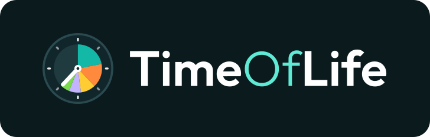
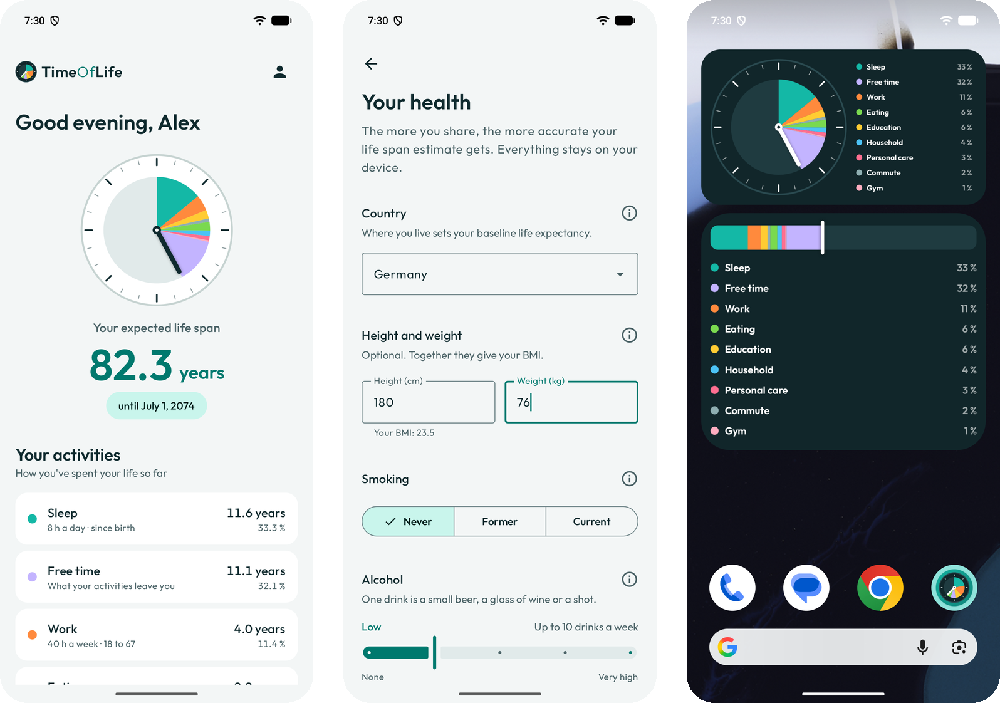

**TimeOfLife shows you how many you have to look forward to, and what you fill them with.**

  



## Your time, made visible

TimeOfLife turns your life into something you can see: the years you have already filled, the many
years still ahead of you, and the things you spend them on. It's a friendly nudge to make the most
of your time.

- **Your years ahead.** TimeOfLife estimates how many years you can look forward to, starting from
  the life expectancy in your country and adding what you do for yourself: not smoking, exercise, a
  healthy weight and more. Every number comes from a large cohort study, and the app explains each
  one. Prefer your own number? Set it yourself at any time.
- **Where your time goes.** Sleep, work, education, commute, eating, household and personal care
  come with realistic defaults, including the part of life they belong to, like work from 18 to 67.
  For each activity you see how much time you've given it so far, how much is still to come, and how
  much free time is left over for everything else.
- **Your own activities.** Add hobbies, sports or anything else you love spending time on. They
  count towards your life just like sleep or work.
- **Always in view.** Two home screen widgets, the *life clock* and the *life bar*, keep your life's
  colors on your home screen.
- **Private by design.** No account, no backend. Your data stays on your device.

The estimate is meant as motivation and orientation, not as a medical prognosis.

## Background

I built TimeOfLife for a close friend who is deeply into self-optimization. He draws a lot of
motivation from apps that make his habits and progress visible, and a clear picture of his own
lifetime, and of how much of it goes into sleep, work or the commute, was something no app gave him
in the way he wanted.

## Tech stack

| Area         | Technology                                                     |
|--------------|----------------------------------------------------------------|
| Language     | Kotlin 2.4, Kotlin Multiplatform (Android, iOS)                |
| Android UI   | Jetpack Compose, Material 3, Navigation 3, RemoteViews widgets |
| Shared logic | Coroutines, kotlinx-datetime, kotlinx-serialization            |
| Persistence  | Jetpack DataStore (Preferences), multiplatform                 |
| DI           | Koin                                                           |
| Quality      | detekt with Compose rules, Kover coverage, GitHub Actions CI   |

## Project status

TimeOfLife is in early development.

- **Android:** the basic functionality works: onboarding, the life span estimate, the activity
  breakdown, custom activities and the two widgets. Many features and refinements are still to come.
- **iOS:** so far only the business logic is shared and tested on iOS. There is no iOS UI yet.
- **Where it's heading:** most of the UI will move into a shared Compose Multiplatform module used
  by both apps. Only parts that need the platform, such as the home screen widgets, stay native.

## Documentation

| Document                                            | Content                                                      |
|-----------------------------------------------------|--------------------------------------------------------------|
| [Architecture](docs/architecture.md)                | Modules, layers, the calculation pipeline, DI and navigation |
| [Development](docs/development.md)                  | Building, running, testing, code quality and CI              |
| [Life span estimation](docs/lifespan-estimation.md) | The estimation method and the study behind every number      |
| [Brand guide](docs/brand/README.md)                 | Logo, color palette and typography                           |

## Quick start

```bash
./gradlew :androidApp:assembleDebug   # build the Android app
./gradlew :sharedLogic:allTests       # run the shared logic tests
```

For iOS, open [`iosApp/`](iosApp) in Xcode. See [Development](docs/development.md) for details.

## Author

**Christian Anders** · [GitHub](https://github.com/ChrAnd2)
