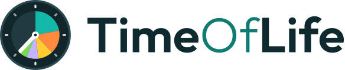

# TimeOfLife brand

## Name

Always **TimeOfLife**: one word, three capitals, no spaces. In the wordmark the "Of" is set lighter
and in teal, so the three words stay readable without spaces. That's styling only; in running
text, write it plain.

## Logo

The mark is the life clock widget, simplified: a 24 h face whose colored pie is the life lived so
far, split by activity, and one hand at "now". The wordmark sits to its right, vertically centered
on the cap height, with a gap of 22 % of the mark's height. The text is 70 % of the mark's height.

| File                                   | Use                                    |
|----------------------------------------|----------------------------------------|
| [`logo.svg`](logo.svg)                 | Logo on light backgrounds              |
| [`logo-on-dark.svg`](logo-on-dark.svg) | Logo on dark backgrounds               |
| [`mark.svg`](mark.svg)                 | Mark alone, e.g. avatars, small spaces |
| [`app-icon.svg`](app-icon.svg)         | App icon look, e.g. for store listings |

In the app, use the `TimeOfLifeLogo` composable instead of an image.

## Colors

The palette is bright, sunny accents (teal, orange, sun yellow, green) on deep teal surfaces in dark
mode and a cool, slightly teal-tinted off-white with white cards in light mode. Activity colors are fixed, so the same activity looks the same
in the app, in both widgets and in the logo.

| Name       | Hex       | Use                                        |
|------------|-----------|--------------------------------------------|
| Deep       | `#0A1A1D` | Dark background                            |
| Panel      | `#11262A` | Widget panels, clock face, dark containers |
| Rim        | `#2A4A50` | Clock rim, dividers on dark                |
| Future     | `#1F3B40` | Time not lived yet                         |
| Mist       | `#F3F6F6` | Light background                           |
| Ink        | `#0F2A2E` | Text on light                              |
| Teal       | `#14B8A6` | Brand color, app icon; sleep               |
| Teal light | `#5EEAD4` | Primary on dark                            |
| Teal deep  | `#0E7C72` | App icon gradient end, "Of" on light       |
| Orange     | `#FF8A3D` | Secondary accent; work                     |
| Sun        | `#FFCC33` | Tertiary accent; education                 |
| Green      | `#7AD94F` | Eating                                     |
| Sky        | `#4CC3F5` | Household                                  |
| Rose       | `#FF6F91` | Personal care                              |
| Sage       | `#8FAFB2` | Commute                                    |
| Lilac      | `#C3B4FF` | Free time                                  |

The Material color schemes for light and dark are in `androidApp/.../ui/theme/Color.kt`. On light
surfaces they use darker shades of teal, orange and sun, so text keeps a contrast of at least 4.5:
1. The app ignores the Android 12+ wallpaper colors on purpose, so it looks the same on every
device.

## Typography

[Outfit](https://github.com/Outfitio/Outfit-Fonts), a geometric sans serif, for everything: SemiBold
for headlines, titles and buttons, Regular for body text, Light only for the "Of" in the wordmark.
Licensed under the
[SIL Open Font License](OFL.txt).

## Changing the brand

When you change a color, change it in `ui/theme/BrandPalette.kt`, in the table above and in the icon
and logo files that use it: the launcher icon and logo mark drawables, the widget picker previews,
the iOS app icons and the SVGs in this folder.
